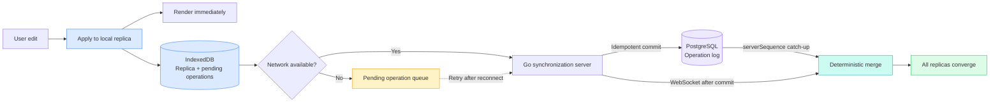

# Converge

Converge is a local-first collaborative incident-response workspace. Browser replicas apply edits immediately, preserve them offline, and deterministically converge after receiving the same operation set.

## Architecture

Local execution is the critical path. Server synchronization is a recoverable background path.



## Verification

```bash
npm install
npm run typecheck
npm test
npm run build:web

cd apps/server
go test ./...
go vet ./...
```

