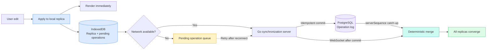

# Converge

Converge is a local-first collaborative text editor. Everyone in a room types into the same text box; edits apply instantly, survive going offline, and merge character by character when replicas reconnect.

## What it does

- **Character-level merging.** The text is a hand-written sequence CRDT (a replicated growable array). Two people typing at once, or one person editing offline, both keep their text.
- **Local-first.** Every keystroke is applied to the browser's own replica and saved in IndexedDB before any network request. The server is a recoverable background path.
- **Proven convergence.** Property-based tests generate random edits on several replicas, deliver the operations shuffled and duplicated, and assert that every replica ends with the same text.
- **Presence.** Each participant gets a colour, appears in the room's list, and has a live caret drawn in everyone else's editor.

## Architecture

Local execution is the critical path. Server synchronization is a recoverable background path.



## How the merge works

Every character has a permanent id: a Lamport timestamp plus the id of the replica that typed it. There are two operations.

- `insert_text` carries a run of characters and the id of the character they were typed after.
- `delete_text` carries the ids of the characters to hide. Deleted characters stay in the replica as invisible tombstones so later operations can still be placed relative to them.

When two replicas insert at the same position, the run with the greater id goes first. Every replica applies that same rule, so they agree without talking to each other, and a run is never interleaved with a concurrent one.

An operation that arrives before the character it refers to is held back and applied when that character shows up. Applying an operation twice changes nothing. Together these mean the result depends only on the *set* of operations received, not on their order or how often they are delivered.

The merge logic lives in `packages/sync-core` as pure functions with no browser or network dependencies. The Go server never interprets the text: it validates, stores and relays operations.

## Design decisions and trade-offs

- **RGA instead of a library.** Writing the CRDT by hand keeps the whole system explainable in one sitting. Fractional indexing was the simpler alternative, but it interleaves concurrent typing at the same spot letter by letter.
- **Tombstones are never collected.** Deleted characters and the operation log grow without bound. Safe collection needs to know that every replica has seen a delete, which this system does not track.
- **One element per code point.** An emoji is never split in half by a concurrent edit. Carets are converted between the DOM's UTF-16 offsets and code points at the edge.
- **The array is copied on each edit.** Simple and safe with React, and fine at the 10,000-character limit; a rope or tree would be needed for large documents.
- **A single server instance.** Live updates are relayed in memory by one Go process. Running several would need a shared channel such as PostgreSQL `LISTEN/NOTIFY`.
- **Presence is ephemeral and unauthenticated.** Carets travel over the WebSocket and are never stored. There are no accounts, so a client could claim another's id.
- **Remote carets are drawn by an overlay.** A textarea cannot contain markup, so a transparent layer mirrors its text and wrapping. It depends on the two layers sharing exactly the same text styles.

## Verification

```bash
npm install
npm run typecheck
npm test
npm run build:web

cd apps/server
go test ./...
go vet ./...
```

